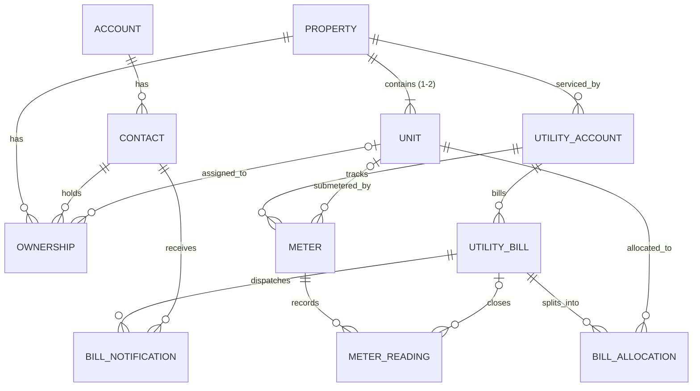

# Bill Split - Salesforce DX Application

> **Production-grade Salesforce solution for splitting dual-occupancy council utility bills between units with private sub-metering, automated calculations, audit logging, owner email notifications, and an Experience Cloud owner portal.**

[](https://developer.salesforce.com/docs/atlas.en-us.sfdx_dev.meta/sfdx_dev/)
[](https://developer.salesforce.com/)
[]()
[-brightgreen.svg)]()

---

## 1. Project Overview & Business Purpose

Dual-occupancy and subdivided duplex residential properties frequently receive a single consolidated council utility bill (such as council water rates or electricity) covering the entire lot. When one unit has a private sub-meter installed, dividing the charges equitably requires:
1. Recording sub-meter readings corresponding to the council billing cycle.
2. Deriving the residual consumption for the non-submetered unit.
3. Apportioning consumption charges proportionally while distributing fixed supply charges equally (50/50).
4. Ensuring splits sum to the bill total to the exact cent.
5. Delivering formal allocation statements to property owners via their preferred billing channels.
6. Providing property owners with secure, read-only self-service access to historical allocations via an Experience Cloud site.

**Bill Split** provides a complete end-to-end Salesforce platform solution implementing this business process with strict data validation, bulkified Apex automation, interactive Lightning Web Components, and automated Apex managed sharing.

---

## 2. Key Features

- **Property & Unit Setup Wizard (`billSplitPropertySetup`)**: Multi-step setup wizard with interactive OpenStreetMap address picking (Leaflet integration) and manual fallback.
- **Sub-Meter Reading Validation**: Rigorous validation preventing future reading dates, backwards consumption readings, or missing baseline opening readings.
- **Deterministic Pure Calculation Engine (`BillSplitCalculator`)**: Pure mathematical Apex engine with zero SOQL/DML dependencies for 100% predictable, testable split logic and exact-cent rounding.
- **Interactive Staff Workbench (`billSplitWorkbench`)**: Embedded directly on the `Utility_Bill__c` record page for closing reading entry, instant split calculation, preview validation, and email dispatch.
- **Audit-Logged Email Notifications (`BillSplitNotificationService`)**: HTML & plain-text statements sent to owners based on communication preferences (`Primary`, `Alternate`, or `Both`), complete with delivery status tracking (`Queued`, `Sent`, `Failed`).
- **Owner Experience Cloud Portal (`billSplitOwnerPortal`)**: Responsive LWR portal for property owners with granular Apex managed sharing (`Property__Share`) ensuring owners see only their properties and bills.
- **Nightly Expiry Batch (`OwnershipSharingBatch`)**: Schedulable batch job automatically revoking portal visibility when ownership end dates expire.

---

## 3. Solution Architecture & Component Interactions

```mermaid
flowchart TD
    subgraph UI_Layer["User Interface Layer (LWC & App)"]
        A[Property Setup Wizard<br/>billSplitPropertySetup]
        B[Leaflet Map Picker<br/>billSplitAddressPicker]
        C[Staff Utility Bill Workbench<br/>billSplitWorkbench]
        D[Experience Cloud Owner Portal<br/>billSplitOwnerPortal]
    end

    subgraph Controller_Layer["Apex Controllers & Services"]
        E[PropertySetupController]
        F[BillSplitController]
        G[OwnerPortalController]
        H[BillSplitService]
        I[BillSplitCalculator<br/>(Pure Engine)]
        J[BillSplitNotificationService]
        K[BillSplitEmailBuilder]
        L[OwnershipSharingService]
    end

    subgraph Data_Layer["Data & Security Layer"]
        M[(Property__c & Unit__c)]
        N[(Utility_Account__c & Meter__c)]
        O[(Meter_Reading__c)]
        P[(Utility_Bill__c)]
        Q[(Bill_Allocation__c)]
        R[(Bill_Notification__c)]
        S[(Property__Share<br/>RowCause: Owner_Access__c)]
    end

    A --> B
    A --> E
    E --> M & N & O
    C --> F
    F --> H
    H --> I
    H --> Q & P
    F --> J
    J --> K
    J --> R & P
    D --> G
    G --> M & P & Q
    L --> S
```

### Component Breakdown
| Class / Component | Type | Responsibility |
|---|---|---|
| `BillSplitCalculator` | Apex Class | Pure mathematical calculation engine; splits usage and fixed supply charges without SOQL/DML. |
| `BillSplitService` | Apex Class | Orchestrates data loading, validation, calculator execution, and atomic transactional upsert of allocations. |
| `BillSplitController` | Apex Controller | `@AuraEnabled` endpoints powering the staff workbench on `Utility_Bill__c`. |
| `BillSplitNotificationService` | Apex Class | Resolves owner recipients, checks deliverability, sends emails, and writes `Bill_Notification__c` audit rows. |
| `BillSplitEmailBuilder` | Apex Class | Generates HTML and plain text email bodies with strict money and date formatting. |
| `OwnershipSharingService` | Apex Class | Manages Apex managed sharing (`Property__Share`) for external portal users. |
| `OwnershipSharingBatch` | Schedulable Batch | Nightly batch job reconciling expired ownerships against active shares. |
| `PropertySetupController` | Apex Controller | Atomic multi-object persistence for properties, units, meters, and baseline readings. |
| `OwnerPortalController` | Apex Controller | Secure `with sharing` read-only controller for Experience Cloud portal users. |
| `billSplitWorkbench` | LWC | Staff workbench for entering closing readings, calculating splits, previewing, and sending. |
| `billSplitAddressPicker` | LWC | Leaflet-based OpenStreetMap integration for geocoding and reverse geocoding. |
| `billSplitOwnerPortal` | LWC | Portal container showing properties, units, bill history, and breakdown. |

---

## 4. Data Model



### Core Objects & Purpose
- **`Property__c`**: Physical lot (discrete address fields, geolocation, council details, status).
- **`Unit__c`**: Subdivided units (e.g. Unit A, Unit B). Restricted to 2 units per property via `Bill_Split_Setting__mdt.Max_Units_Per_Property__c`.
- **`Ownership__c`**: Junction linking Contact/Account to Property and optional Unit. Governs billing email preferences (`Primary`, `Alternate`, `Both`) and portal access.
- **`Utility_Account__c`**: Council utility account (Water, Electricity, Gas) tied to a property with billing frequency and unit of measure.
- **`Meter__c`**: Tracks physical meters (`Sub` or `Main`) assigned to a specific unit.
- **`Meter_Reading__c`**: Historical readings (`Baseline`, `Bill Close`, `Interim`) with date sequence validation.
- **`Utility_Bill__c`**: Council master bill record containing billing period, total units, gross amount, and supply charges.
- **`Bill_Allocation__c`**: Calculated per-unit split allocation storing consumption, usage charges, supply charges, and audit notes.
- **`Bill_Notification__c`**: Immutable audit log of every email dispatch with status (`Queued`, `Sent`, `Failed`) and error details.
- **`Bill_Split_Setting__mdt`**: Custom metadata controlling unit limits, reading tolerance windows, and sender addresses.

---

## 5. Security & Access Control

### Permission Sets & Groups
- **`Bill_Split_Admin`**: Full CRUD and View All / Modify All on all custom objects, Apex classes, custom metadata, and system tools.
- **`Bill_Split_Staff`**: Operational access to properties, bills, readings, and wizard. Read-only on allocations and notifications. Includes `Send_Bill_Split`.
- **`Bill_Split_UI_Access`**: Access to staff controllers and the Property Setup tab.
- **`Bill_Split_Staff_Group`**: Bundles staff permissions for streamlined user assignment.
- **`Bill_Split_Portal_Owner` / `Bill_Split_Portal_Access`**: External read-only access for Experience Cloud owners.

### Custom Permissions
- **`Send_Bill_Split`**: Authorizes staff to execute email dispatches.
- **`Reopen_Sent_Bill`**: Allows recalculating and unlocking an already-sent bill.

### Sharing Model
- **`Property__c`**: Private internal and external OWD.
- **Child Objects**: Controlled by Parent (Master-Detail).
- **Apex Managed Sharing**: External portal users receive read access to `Property__c` via `Property__Share` records with RowCause `Owner_Access__c`.

---

## 6. Deployment & Quick Start

For detailed step-by-step instructions, troubleshooting, and Experience Cloud setup, see the complete [DEPLOYMENT.md](/BillSplit/DEPLOYMENT.md).

### Quick Deploy via Salesforce CLI (`sf`)

```bash
# 1. Authorize target org
sf org login web --alias billsplit-target --set-default

# 2. Deploy metadata using project manifest
sf project deploy start \
  --target-org billsplit-target \
  --manifest manifest/package.xml \
  --test-level RunLocalTests \
  --verbose

# 3. Assign Admin permission sets
sf org assign permset \
  --name Bill_Split_Admin \
  --name Bill_Split_UI_Access \
  --target-org billsplit-target

# 4. Schedule nightly sharing sync batch
sf apex run --file scripts/promote/05-post-deploy-prod.apex --target-org billsplit-target

# 5. Populate demo seed data
sf apex run --file scripts/apex/seed-data.apex --target-org billsplit-target

# 6. Run demo split calculation
sf apex run --file scripts/apex/calculate-demo.apex --target-org billsplit-target
```

---

## 7. Known Limitations & Design Assumptions

1. **Dual Occupancy Scope**: Phase 1 supports properties with up to 2 units and 1 sub-meter (Submeter Residual method).
2. **Utility Type Focus**: Built and tested primarily for Water (`kL`); data model supports Electricity (`kWh`) and Gas (`MJ`) for future phases.
3. **Rollover / Meter Replacement**: Meter index resets (rollover) require creating a new `Meter__c` record with a `Baseline` reading.
4. **GST Treatment**: Bill gross totals are processed GST-inclusive without separate tax breakdown lines.
5. **Single Currency**: Standard single-currency orgs (AUD). Multi-currency is not supported.

---

## 8. Repository Structure

```
├── .forceignore                     # CLI deployment exclusions
├── .gitignore                       # Git exclusions (caches, logs, secrets)
├── DEPLOYMENT.md                    # Target org deployment runbook
├── README.md                        # Project documentation (this file)
├── package.json                     # Node scripts & LWC linter dependencies
├── sfdx-project.json                # Salesforce DX project definition
├── config/
│   └── project-scratch-def.json     # Scratch org definition
├── manifest/
│   └── package.xml                  # Metadata manifest for releases
├── scripts/
│   ├── apex/                        # Operational Apex scripts (seed data, demo)
│   └── promote/                     # Shell deployment and validation scripts
├── documents/                       # Solution design & phase documentation
└── force-app/main/default/          # Core Salesforce source metadata
    ├── applications/                # Bill Split Lightning App
    ├── classes/                     # Apex classes, services, controllers, tests
    ├── cspTrustedSites/             # OpenStreetMap CSP trusted sites
    ├── customMetadata/              # Bill Split custom metadata records
    ├── customPermissions/           # Send_Bill_Split, Reopen_Sent_Bill
    ├── digitalExperienceConfigs/    # Experience Cloud site definitions
    ├── flexipages/                  # Lightning Record Pages & App Pages
    ├── globalValueSets/             # AU_State (Australian States)
    ├── lwc/                         # Lightning Web Components
    ├── networks/                    # Community / Experience Cloud network config
    ├── objects/                     # Custom objects & field extensions
    ├── permissionsetgroups/         # Permission set groups
    ├── permissionsets/              # Permission sets
    ├── profiles/                    # Staff and Portal profiles
    ├── roles/                       # Bill Split user roles
    ├── sites/                       # Experience Cloud custom sites
    ├── staticresources/             # Leaflet 1.9.4 map library
    ├── tabs/                        # Custom tabs
    └── triggers/                    # Apex triggers & handlers
```
